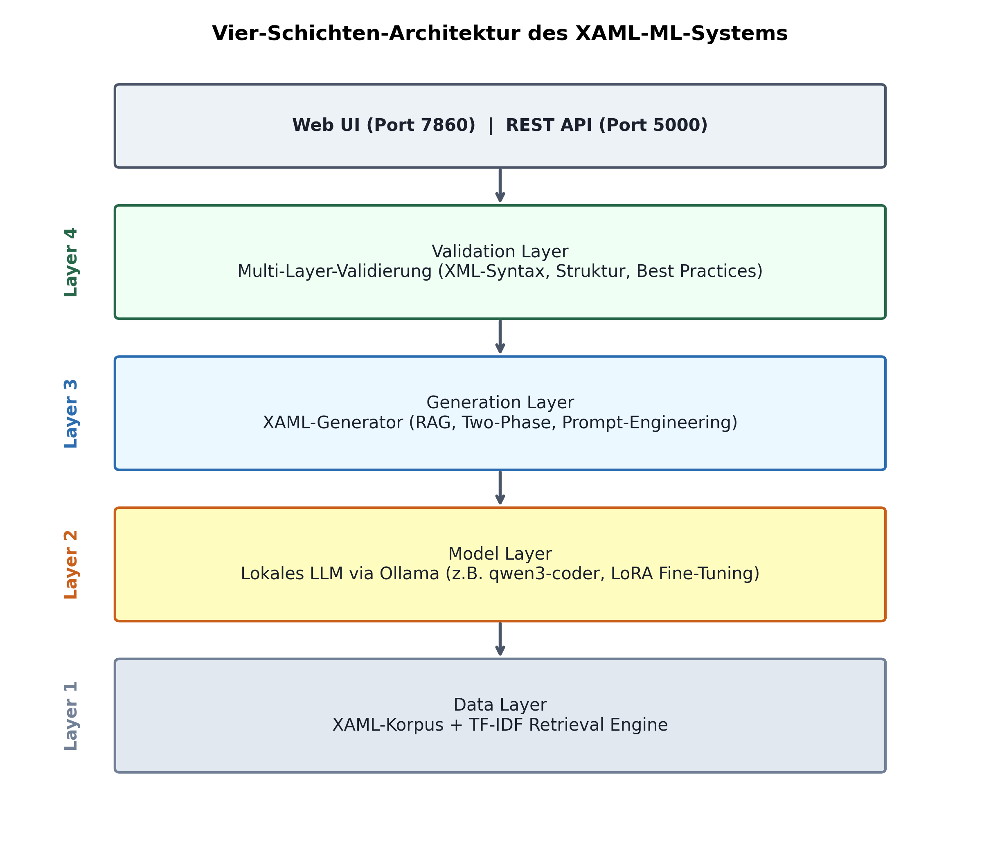

# flowsmith — LLM-generated UiPath workflows ("Automating the automation")

Turn a plain-language task description into a runnable **UiPath XAML workflow** with a local LLM,
then check and repair it automatically against RPA best practices.

Built as the practical part of my master's thesis *"Automatisierung der Automation — a method for
AI-assisted generation and optimisation of RPA workflows"* (M.Sc. Data Engineering & Consulting,
Hochschule Albstadt-Sigmaringen, 2026). Everything runs locally (Ollama) — no workflow data leaves the machine.



## How it works

| Stage | Module | What it does |
|---|---|---|
| Preprocessing | `src/training/preprocessor.py` | Parses existing XAML workflows, categorises them (SAP / web / Excel / mail / file …), scores quality with a best-practice rubric (try/catch, logging, arguments, display names, no plaintext passwords …) and splits them into *RAG-only* and *fine-tuning grade*. |
| Training pairs | `src/training/pair_builder.py` | Self-supervised repair pairs: good workflows are deliberately degraded (remove try/catch or logging, hard-code credentials, magic numbers …) so the model learns *bad → good*. |
| Fine-tuning | `src/training/trainer.py` | QLoRA with Unsloth (r = 16, α = 16) on **Qwen2.5-Coder-7B-Instruct**, exported to GGUF (Q4_K_M) and imported into Ollama. |
| Retrieval | `src/generation/rag_engine.py` | Retrieves similar reference workflows as context for the generator. |
| Two-phase generation | `src/generation/two_phase_generator.py`, `spec_compiler.py`, `activity_templates.py` | Phase 1: the LLM writes a structured **workflow spec** (JSON). Phase 2: a deterministic compiler turns the spec into XAML from vetted activity templates — the model never has to emit raw XML. |
| Repair | `src/generation/surgical_repair.py` | Targeted fixes of validator findings instead of regenerating the whole file. |
| Validation | `src/validation/validator.py` | Layered check (XML syntax → activity whitelist → best-practice rules → optional LLM review); weighted score 0–100 from structure 35 %, logging 25 %, naming 15 %, security 15 %, completeness 10 %; pass threshold 70. |
| Apps | `src/api/app.py`, `desktop_app.py` | Flask API (streaming) and a desktop front end. |

## Results (from `results/benchmark_*.json`)

Latest ablation run (21 June 2026, 5 tasks: SAP ME22N price check, Excel filter, web login + download, mail attachments, SQL → Excel):

| Strategy | Avg. best-practice score | Pass rate (≥ 70) |
|---|---|---|
| A) Direct generation (baseline) | 55.8 ± 21.9 | 20 % |
| B) Baseline + repair | 73.3 ± 17.6 | 40 % |
| **C) Two-phase (spec → compiler)** | **93.0 ± 8.2** | **100 %** |
| D) Two-phase + repair | 93.0 ± 8.2 | 100 % |

An earlier run (18 June, 8 tasks, different model settings) was much weaker for the two-phase variants
(avg. 43.9 / 22.9) — both runs are included unfiltered. Sample sizes are small; treat this as a
**proof of concept**, not a benchmark.

> **Important caveat.** These scores come from the project's own best-practice validator (try/catch, logging,
> naming ...). They do **not** prove that UiPath Studio can open the file. When I built the June outputs with the real
> UiPath toolchain in November 2026, they did not load (wrong type syntax, a legacy VB settings block, invalid
> activity properties, undeclared variables ...). The compiler was fixed accordingly — see below.

## Does the output really build in UiPath? (checked 24 Nov 2026)

`scripts/uipath_build_check.py` puts every XAML into a blank UiPath project and runs `uip rpa build`
(compilation + Workflow Analyzer, UiPath CLI 1.206).

| Check | Result |
|---|---|
| Compiler, 6 activity groups (core/assign, files, Excel, mail, web, HTTP) | **6/6 build** |
| End-to-end, 5 tasks I developed against → local LLM (qwen3:14b) → XAML → UiPath build | 5/5 build (PDF archive, REST status check, CSV → Excel, file → mail, web search) — **optimistic**, I tuned the compiler on these |
| End-to-end, the same 5 task types re-run from the command line, 3 rounds, no tuning in between | **11–12 of 15 build (73–80 %)**; the model is not deterministic, so ±2 per round is noise at this sample size |
| Compiler with `If` / `ForEach` / JSON access (hand-written spec, no LLM) | builds, 0 placeholders |
| Regression tests (`tests/`, no UiPath, no LLM) | 56 passed; GitHub Actions runs them on Python 3.10 and 3.12 |

Building is **not** the same as running: selectors are placeholders, credentials/servers are examples, and the
process logic needs a human review in Studio.

**Known limits (measured on 24 Nov 2026):**

- Roughly one in four generated workflows still fails the UiPath build. Typical causes: a JSON value used as `Object`
  where `String` is required, a `String` used where a list is expected, Excel/DataTable type mismatches.
- Activity types the compiler does not implement become a visible `[TODO: Implementieren]` log step instead of silent
  nothing: 8 such steps in 15 files. `examples/generated/api_status.xaml` contains two of them.
- `If` and `ForEach` are compiled (child steps are referenced by id), but the prompt does not teach the model that
  format. I tried a longer prompt that did: it scored 7/15, worse than before, and I dropped it
  (small sample, so "probably worse" rather than proven). A better route is probably few-shot examples or
  constrained JSON output; not done.
- Fine-tuning was only tried on a very small dataset; the benchmark effect comes from the two-phase design.
- The desktop app and the web UI were not click-tested; the API is covered by `tests/test_api_security.py`.

## What is (and isn't) in this repository

- ✅ Full source code, configuration, figures, benchmark results, dataset statistics (`results/dataset_stats`).
- ✅ Two synthetic example workflows in `data/raw/` and five model-generated workflows with their specs in `examples/generated/` (all build in UiPath, see above).
- ❌ **Training data:** the thesis used 10 real enterprise workflows from my former employer. They are proprietary and not published; the pipeline runs on any folder of your own `.xaml` files.
- ❌ Fine-tuned model weights (4.7 GB GGUF) and the thesis document.

The training set was small (10 workflows → 9 accepted, 1 fine-tuning grade, 25 repair pairs), which is the main limitation of the fine-tuning part.
The strongest effect in the benchmark comes from the **two-phase spec → compiler design**, not from fine-tuning.

## Security notes (found by testing a fresh clone, fixed 24 Nov 2026)

The local API used to have real holes; `tests/test_api_security.py` (23 cases, 21 of them fail on the old code) now pins the fixes:

- `/api/download*`: the old check was `startswith()` on an unresolved path, so `..` escaped the output folder. Now `resolve()` + `relative_to()`.
- CORS: was open to every origin; now only the local UI origins (configurable in `config.yaml`).
- Training endpoints accepted arbitrary directories; now confined to the data root.
- Model names are validated before they reach Ollama (no leading `-`, no spaces/shell characters).
- The server binds to `127.0.0.1` by default and no longer runs with `debug=True`.
- `scripts/start_system.py --help` used to start servers and pull a 4 GB model; it now has real argument parsing and `--pull-model` is opt-in.

There is no authentication: this is a local tool. Do not expose it to a network.

## Quick start

```bash
# 1) Ollama + a base model
ollama pull qwen3:14b            # or qwen3:8b with 16 GB RAM
# 2) Python dependencies
pip install -r requirements.txt -r requirements_desktop.txt
# 3) Run
python desktop_app.py            # or: python scripts/start_system.py
python scripts/generate.py --help
python scripts/train.py --skip-preprocess --help   # training (LoRA needs a GPU: requirements_lora.txt)
```

Verified on 24 Nov 2026 on a clean copy of this repository: preprocessing processed both example workflows
(2/2, 0 errors); the validator scored them 83 and 98, and a deliberately degraded copy (logging and display names removed)
dropped from 98 to 63 and failed.

## Project structure

```
src/        training, generation, validation, api
scripts/    benchmark, generate, train, figures, results
config/     config.yaml + activity templates
data/raw/   put your own .xaml workflows here (two synthetic examples included)
results/    benchmark runs + dataset statistics
figures/    thesis figures (architecture, LoRA, RAG, validation, case studies, ablation)
```

## Deutsch (Kurzfassung)

KI-gestützte Erzeugung von UiPath-Workflows aus Klartext: lokale LLMs (Ollama, Qwen), RAG, QLoRA-Feinabstimmung,
zweistufige Generierung (Spezifikation → deterministischer Compiler), gezielte Reparatur und mehrstufige Validierung.
Praxisteil meiner Masterarbeit. Die ursprünglichen Trainingsdaten (Workflows eines früheren Arbeitgebers) sind
nicht enthalten. Startanleitung: [STARTEN.md](STARTEN.md).

## License

MIT — see [LICENSE](LICENSE). Author: Nico Vogel ([@gh0stsyntax](https://github.com/gh0stsyntax)).
